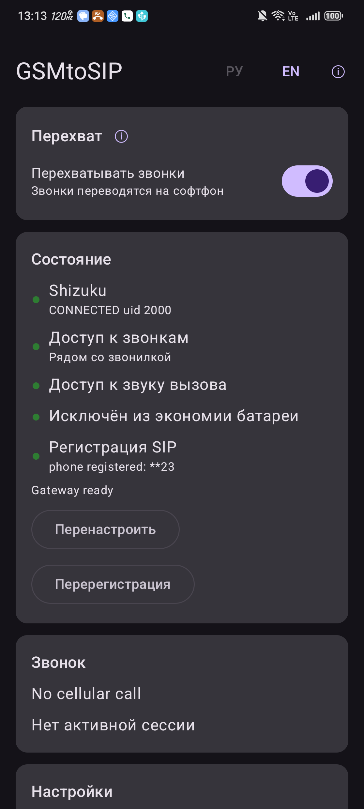

# voice-sip-agent-selfhost - a "device-in-itself" phone gateway, no root (Android 13+)

> 🇷🇺 **[Русская версия →](README.ru.md)** (fuller, with the project's own notes) ·
> 🇬🇧 English (this file). Original project README: [`README.upstream.md`](README.upstream.md).

> 👉 **New here?** A plain-language, from-scratch step-by-step guide (install this, enable that,
> forward ports) is in [`docs/КАК-НАСТРОИТЬ.md`](docs/КАК-НАСТРОИТЬ.md) (Russian).

## Documentation map

- **For users:** [`docs/КАК-НАСТРОИТЬ.md`](docs/КАК-НАСТРОИТЬ.md) - the single page that's enough
  to set everything up from scratch (Russian).
- **Reference:** [app settings](docs/settings-ru.md) · [baresip client](docs/client-baresip.md) ·
  [Shizuku after a reboot](docs/shizuku-reboot.md) · [internet and security](docs/internet-security.md).
- **For developers:** [building the APK](#building-the-apk).

A fairly recent old Android phone with your SIM sits at home on a charger and Wi-Fi. The incoming
**voice calls and SMS** that arrive on its number are relayed to your phone over the internet -
wherever you are. **No PC, no Asterisk, no external server:** the SIP server is built into the app.
**No root required.**

```
Caller ──GSM/VoLTE──► Gateway phone (SIM + app)
                         ├─ built-in SIP registrar :5062 ◄─REGISTER─ softphone (anywhere)
                         ├─ answers the call itself, call audio ↔ SIP (RTP)
                         └─ incoming SMS → SIP MESSAGE ──────────► softphone chat
```

This is **track A** of the larger "переадресация" project. Track B (a fork of
[gsm2sip](https://github.com/pulpoff/gsm2sip), **with root**, old Qualcomm phones below
Android 13, such as the Samsung S4 mini) lives in the separate `gsm2sip-selfhost` repository.

The key to doing this without root: since **Android 13** the system has a standard but hidden
call-audio interception mechanism (`TELEPHONY_TX`/`TELEPHONY_RX`). Access is granted by **Shizuku**,
started once with a debugging command.

---

## Who it's for

Your home number (SIM) anchors your bank, government services, 2FA codes, and calls from family
and services - carrying it around is both inconvenient and risky. This gateway keeps the SIM
**at home** and delivers its calls and SMS to you over the internet, on any phone, wherever you are.

- **Vacation / business trip.** No roaming, no missed incoming on your home number, no changing
  numbers. On the road your phone carries a local eSIM or a second SIM for data only; the home SIM
  stays in the gateway at home.
- **Long relocation / living abroad** (expat, student, rotational work). Your home number stays
  "alive" and tied to your accounts while you are in another country: bank calls and SMS codes
  arrive as before.
- **Safety on the street.** If your phone is stolen or snatched in an unfamiliar city, the home SIM
  **isn't in it** - it's at home. The thief gets no access to your number, can't intercept SMS
  codes, can't reset passwords by SMS, and can't reach SIM-bound accounts or your bank. The stolen
  phone holds only a local data eSIM or an "empty" second SIM with no important bindings.
- **Privacy and control.** A "device-in-itself": the SIP server lives inside the gateway phone,
  audio and messages go straight to your softphone - no clouds, no third-party servers.

**For:** travelers and digital nomads, expats, rotational workers, students abroad; anyone who
keeps an "anchor" number for banks and government services and doesn't want to carry it; and anyone
who values privacy (no external server).

---

## What already works

Verified on a **Nubia NX769J (Android 16)** paired with the baresip client:

- ✅ Incoming GSM call to the gateway's SIM → the softphone rings on the other phone, **two-way
  audio** (needs the **"Direct telephony"** capture method - see [settings](docs/settings-ru.md), §4.4).
- ✅ Built-in SIP registrar: the softphone registers straight to the gateway phone.
- ✅ Incoming **SMS** → arrives in the softphone chat.
- ✅ Self-recovery: after the app restarts, the link comes back within ≤2 minutes.
- ✅ All settings are **in the app itself** (RU/EN), each item has an ⓘ explanation.
- ✅ Doze resilience: the service holds a wakelock while the gateway is on, so the phone doesn't drop
  the registration while asleep, even on aggressive OEM ROMs (0.2.0-selfhost4).

Not done yet: outgoing calls/SMS from the far phone over the gateway's SIM; wideband audio
(currently G.711). Working outside a single Wi-Fi needs a public IP (see below).

> ⚠ **The capture method depends on the phone model.** On the Nubia it's "Direct telephony"; the
> automatic mode chose wrong (no audio). Another phone may need "Call redirection". How to tell -
> [`docs/settings-ru.md`](docs/settings-ru.md), §4.4.
>
> ⚠ **A foreign VPN on the gateway phone breaks registration** - it wraps SIP into the tunnel and
> the softphone hangs on connect. Turn off any VPN on the gateway phone.
>
> ⚠ **Without root, Shizuku dies on a phone reboot** - it must be restarted. This is track A's main
> operational caveat, see [the section below](#shizuku-after-a-reboot).

---

## How this fork differs from upstream

Stock [android-voice-sip-agent](https://github.com/sparkcyf/android-voice-sip-agent) registers to an
**external** PBX. This fork adds:

- a **built-in registrar** ("device-in-itself"): the app accepts REGISTER on `:5062` itself, no
  external PBX needed (on by default);
- **forwarding of incoming SMS** to SIP (`MESSAGE`);
- a **configurable registration lease** (`registrarLeaseSec`, default 600 s) with the last contact
  held for ~2× the lease - brief background sleeps on the softphone don't drop the link;
- a **Russian/English UI** with ⓘ explanations and an FAQ section;
- a **wakelock** held while the gateway runs, so Doze on an aggressive ROM can't suspend the SIP
  reader thread;
- a build **without native pjsip**: by default a pure-Kotlin SIP stack is used (**UDP only, G.711
  codec**). This also matters for [licensing](#license-and-credits): the default build statically
  links **no** pjsip/OpenSSL/libopus.

---

## Gateway phone requirements

- **Android 13 or newer**, **arm64** CPU.
- A **Qualcomm or MediaTek** chip with a call-audio route (checked by one command, below).
  **Exynos (Samsung)** and carrier-locked phones (Verizon, etc.) are **not** suitable.
- A voice SIM; stable Wi-Fi; permanent charging.
- A dedicated phone with no personal data: it lives with debugging and Shizuku enabled.

### Suitability check (no install, over USB)

```bash
adb shell getprop ro.build.version.release                 # need >= 13
adb shell getprop ro.product.cpu.abi                       # need arm64-v8a
adb shell "dumpsys media.audio_policy | grep -E 'TELEPHONY_TX|TELEPHONY_RX'"
```
If the last command shows both lines - the phone is a candidate. Final confirmation comes from the
app (`pstn_interceptable=true`) and a live call.

---

## Which phone to pick

- Android 13+ (almost any phone from 2023 on), **arm64**, **Qualcomm (Snapdragon)** or
  **MediaTek (Dimensity/Helio)**.
- **NOT** Exynos (Samsung) and **NOT** tablet/"Go" chips without telephony.
- No carrier lock (SIM-free / "international" version).
- The cheaper the better - it's a dedicated "duty" phone on a charger.

If you're willing to root the phone, root removes track A's only drawback (see
[Shizuku](#shizuku-after-a-reboot)): on a rooted phone Shizuku starts itself after a reboot. Phones
that root well: Pixel, Xiaomi/Redmi/POCO, Motorola, OnePlus, Nothing; poorly - Samsung, carrier
units, many Transsion.

**Triage script** - `triage/check-phone.sh` in the larger project: `bash check-phone.sh` over USB
gives "CANDIDATE/NOPE", the working audio method, bootloader state, and the recommended track (A/B).

---

## Installing on the gateway phone

> 📦 **Prebuilt files are in [Releases](https://github.com/Hinduc0der/voice-sip-agent-selfhost/releases):**
> the `voice-sip-agent-selfhost-*.apk` installs directly - building is optional (see
> [Building the APK](#building-the-apk)). Get Shizuku from its own [Releases](https://github.com/RikkaApps/Shizuku/releases).

1. Enable Developer options → USB debugging, connect to a PC, allow debugging.
2. Install **Shizuku** (patched one on MediaTek/Xiaomi/Android 16, where the normal build crashes):
   ```bash
   adb install shizuku.apk
   ```
3. Install the gateway app:
   ```bash
   adb install voice-sip-agent-selfhost.apk
   ```
4. Start Shizuku (**repeat after every phone reboot**, see [the section](#shizuku-after-a-reboot)):
   ```bash
   P=$(adb shell pm path moe.shizuku.privileged.api | sed 's/package://;s/base.apk//' | tr -d '\r')
   adb shell "${P}lib/arm64/libshizuku.so"
   ```
   Without a PC, Shizuku starts via "Wireless debugging" on the phone itself.
5. Open the app → **Grant Shizuku** → "Always allow".
6. Grant permissions (the app asks itself; via adb):
   ```bash
   adb shell pm grant io.github.sparkcyf.voicesipagent android.permission.READ_PHONE_NUMBERS
   adb shell pm grant io.github.sparkcyf.voicesipagent android.permission.RECEIVE_SMS
   ```
7. **Server mode is on by default.** Find the gateway's IP:
   ```bash
   adb shell "ip -4 addr show wlan0 | grep -o 'inet [0-9.]*'"
   ```
   The port is **5062/UDP** (default).
8. **Turn off battery optimization** for the app and Shizuku (especially ZTE/Nubia/Xiaomi), or the
   ROM will kill the process.

---

## App settings

Everything is configured **in the app** (RU/EN toggle at the top, an ⓘ on each item). The only
value that really differs from phone to phone is the **capture method ("Cellular audio")**: if the
call connects but people can't hear each other, flip exactly that.



**The full settings reference with screenshots** - [`docs/settings-ru.md`](docs/settings-ru.md)
(Russian).

Short version for "device-in-itself" mode:

| Item | Value |
|---|---|
| Device-in-itself mode (built-in SIP server) | **on** (default) - PBX fields can stay empty |
| Local SIP port | **5062** |
| Registration lease | **600 s** (raise to 1200 if registration keeps expiring) |
| Cellular audio | **Direct telephony** on the Nubia; otherwise try Call redirection (§4.4) |

---

## Recommended client - baresip

The far phone needs a SIP softphone. We recommend
**[baresip](https://f-droid.org/packages/com.tutpro.baresip/)** (`com.tutpro.baresip`, F-Droid): a
free libre client that holds several accounts and always sends page-mode `MESSAGE` (important for
SMS; **Linphone 6.2.x won't send outgoing SMS**).

Quick setup: ⋮ → "Accounts" → `sip:s23@<gateway-IP>:5062` → "+" → enable "Register". No
password/proxy needed. **The `:5062` port is mandatory right in the AoR**, or everything goes to
`:5060`.

Full client guide (two SIMs → one softphone, SMS replies, alternatives) -
[`docs/client-baresip.md`](docs/client-baresip.md) (Russian).

---

## Shizuku after a reboot

The call-audio interception needs debugging-level rights (Shizuku). **On a non-root phone Shizuku
dies on every reboot** - and the gateway stops working until Shizuku is restarted (cable or wireless
debugging). For the "sits at home while I travel" role this is the main risk.

- **Root solves it cleanly:** Shizuku's "Start on boot" (**root only**) brings it up right after
  power-on, no PC. Plus app auto-start and a battery exemption → a **fully unattended gateway**.
- **Without root:** either don't reboot the phone, or keep a small always-on PC/SBC nearby that runs
  the start command over USB/Wi-Fi-adb at boot.

Commands, paths and diagnostics - [`docs/shizuku-reboot.md`](docs/shizuku-reboot.md) (Russian).
(Deep sleep *while running* is already handled by the wakelock since 0.2.0-selfhost4; only the
after-reboot start remains.)

---

## Going to the internet, and security

In one Wi-Fi it just works. To reach the gateway "from the road" it must be reachable from the
internet. **The path is direct access:** a public IP at home plus forwarding of the SIP port and
RTP (**1:1, same port numbers**), with the gateway itself closed off by the registrar password.

> ⛔ An open SIP port is a toll-fraud risk. The gateway is protected by a **SIP registrar password**
> (digest authentication, RFC 2617/3261, MD5): a missing or wrong password is rejected with 401, and
> **brute-force protection** bans an IP for 10 minutes after 5 failed attempts in 60 seconds. The
> password is stored in the Android Keystore (AES-GCM, realm `voice-sip-agent`). An **empty password
> disables authentication** (local network only) - for the internet a password is mandatory. A
> non-standard port is camouflage, not protection; **no VPN is needed.**

Full step-by-step (direct access, the registrar password, security) -
[`docs/internet-security.md`](docs/internet-security.md) (Russian).

---

## Diagnostics (adb)

```bash
R=io.github.sparkcyf.voicesipagent/io.github.sparkcyf.voicesipagent.app.AdbControlReceiver
adb shell am broadcast -n $R --es op status                       # state summary to the log
adb shell am broadcast -n $R --es op sms-test --es from "+700..." --es text "hi"  # SMS test
adb shell am broadcast -n $R --es op takeover --ez on false       # turn the gateway off
adb logcat -s VoiceSipAgent VsaTap VsaPrivileged                  # gateway log
```
In a call log the key lines: `both legs connected` and `media bridged` - audio joined; nonzero
`levels downPeak/upPeak` on both sides = heard both ways (`upPeak=0` usually means the softphone
wasn't granted the mic). All settings-over-adb are in
[`docs/settings-ru.md`](docs/settings-ru.md), §7.

---

## Building the APK

JDK 17 and the Android SDK are required. pjsip/swig are **not** needed - the fork builds on the
pure-Kotlin SIP stack.
```bash
cd voice-sip-agent-selfhost
export JAVA_HOME="/c/Program Files/Eclipse Adoptium/jdk-17.0.20.101-hotspot"
./gradlew :app:assembleDebug
# APK: app/build/outputs/apk/debug/app-debug.apk
```

---

## Honest status and risks

- Incoming call (two-way audio), incoming SMS, built-in registrar - **confirmed** on the Nubia NX769J.
- Outgoing calls/SMS from the far phone over the gateway's SIM - **not done**.
- **The internet path is not yet tested live** - a single Wi-Fi only.
- **Without root, Shizuku does not survive a reboot** - the main operational risk (above).
- **Registrar authentication is implemented** (SIP digest password + brute-force ban); for the
  internet, set a password - an empty password leaves `:5062` open.

---

## Support the project (donate)

Non-commercial, distributed directly (APK), not via app stores. If it's useful to you, you can
**voluntarily** support development:

- **DonationAlerts:** [donationalerts.com/r/hinducoder](https://www.donationalerts.com/r/hinducoder)

> The donation is **entirely voluntary** and changes nothing: the app stays free under
> GPL-2.0-or-later, all features work without paying, and the source is open. Not a purchase or
> subscription.

---

## License and credits

A fork of [**sparkcyf/android-voice-sip-agent**](https://github.com/sparkcyf/android-voice-sip-agent).
License - **GNU GPL, version 2 or later** (GPL-2.0-or-later; see [`LICENSE`](LICENSE)). Our changes
are distributed under the same terms - the repository stays open.

Third-party note: upstream statically links pjsip (GPL-2.0-or-later), OpenSSL (Apache-2.0) and
libopus (BSD-3-Clause) in release builds. **This fork builds on a pure-Kotlin SIP stack with no
native pjsip by default**, so the default build does not include those libraries. Enabling the
`pjsua2` stack brings their licenses back (see the note in [`README.upstream.md`](README.upstream.md)).

The original README is preserved as [`README.upstream.md`](README.upstream.md).
Thanks to the author for the Shizuku-based call-audio interception - track A without root rests on it.

**Credits.** The code was written by Claude (Anthropic) to the owner's tasks; the owner set the
tasks and tested every build on a live device.
