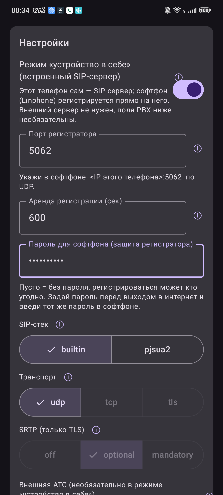
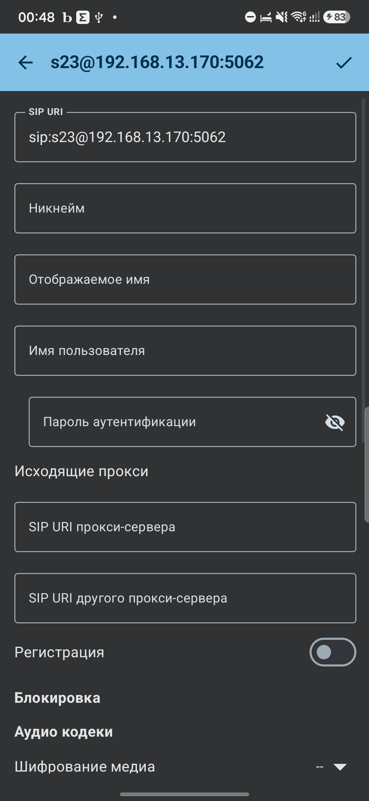
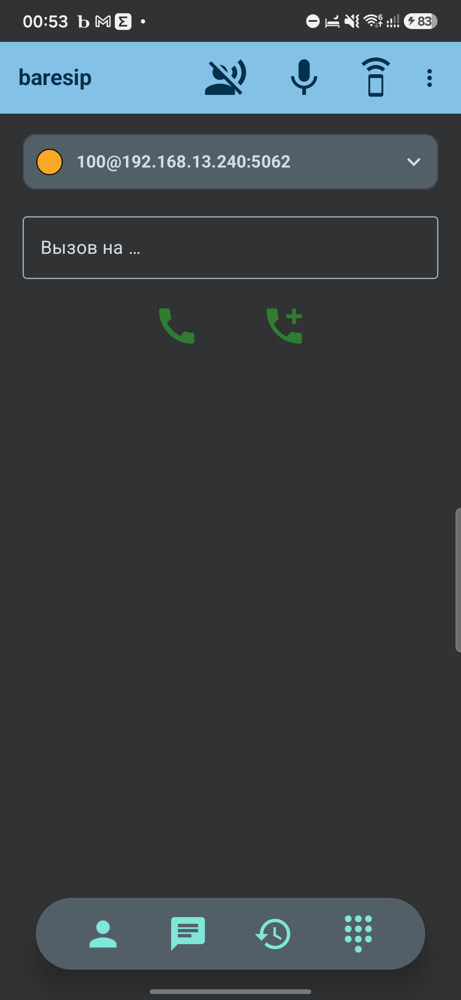

# Вывод в интернет и безопасность

Пока шлюз и дальний телефон в одной Wi-Fi - всё работает «как есть». Чтобы звонки и SMS
доходили **из любой точки**, шлюз должен быть доступен из интернета. Путь один - прямой доступ:
белый IP дома плюс проброс портов, а сам шлюз закрыт паролем SIP-регистратора.

## Прямой доступ (белый IP + проброс портов)

Нужен **белый (публичный, без CGNAT) IP** дома - то есть роутер виден из интернета по своему
адресу. Телефон-шлюз стоит за этим роутером.

1. **DHCP-резервация.** На роутере закрепи LAN-адрес шлюза по его MAC (Wi-Fi), чтобы он не
   менялся - на него смотрят пробросы.
2. **Проброс UDP** на роутере:

   | Внешний порт | → Внутренний (шлюз) | Что |
   |---|---|---|
   | UDP **`<SIP-порт>`** | `<IP шлюза>:<тот же порт>` | SIP (REGISTER, INVITE, MESSAGE…) |
   | UDP **`<RTP-диапазон>`** | `<IP шлюза>:<тот же диапазон>` | звук (RTP), **1:1, те же номера портов** |

   > RTP пробрасывать **без трансляции номеров** (внешний порт = внутренний). Иначе шлюз укажет
   > в SDP один порт, а роутер отдаст другой - и звук уйдёт не туда.
3. **Клиент** нацель на `<белый IP или домен>:<SIP-порт>`. Если есть DDNS - лучше по домену:
   смена IP тогда не ломает клиента.

### Какой SIP-порт выбрать

Рекомендуется **свой случайный высокий порт**, не связанный с SIP: **не** 5060/5061/5062, а
что-нибудь из диапазона **20000-60000**. Автоматические SIP-сканеры в первую очередь долбят
стандартные порты, так что нестандартный снижает их фон.

> ⚠ Это **маскировка, а не защита.** Нестандартный порт лишь уменьшает шум сканеров; тот, кто
> целенаправленно просканирует твой IP, найдёт порт за минуты. Безопасность дают меры из
> следующего раздела, а не выбор номера.

- **В этом репозитории (avsa, трек A)** SIP-порт регистратора **настраивается прямо в
  приложении** (пункт «Local SIP port», по умолчанию `5062`) - смени его там и пробрось новый.
- **В репозитории gsm2sip (трек B)** порт сейчас **зашит в коде (`5062`)**; сменить его можно
  только правкой исходника и пересборкой.

## ⛔ Безопасность прямого доступа - читать обязательно

Открытый в интернет SIP-порт - это toll-fraud риск. Если защиты нет, любой, кто найдёт порт, может:

- **зарегистрироваться на твой номер** и перехватывать входящие звонки (шлюз звонит первой живой
  регистрации);
- заставить шлюз **звонить и слать SMS по GSM наружу** - это реальные деньги.

SIP-сканеры постоянно щупают интернет, так что открытый порт рано или поздно найдут. Выставлять
его без пароля наружу нельзя.

### Защита: пароль SIP-регистратора (реализовано)

Шлюз закрыт паролем через **SIP digest-аутентификацию** (RFC 2617/3261, MD5, `qop=auth`) - это тот
же механизм, которым защищаются Asterisk и любой нормальный SIP-сервер. Работает так:

- на `REGISTER` без учётных данных или с неверным паролем регистратор отвечает **401
  WWW-Authenticate** с `realm` и `nonce`;
- софтфон повторяет запрос, подставив пароль; регистратор проверяет ответ (сравнение в постоянное
  время) и только тогда регистрирует.

Встроена **защита от перебора**: 5 неудачных попыток с неверным паролем за 60 секунд → IP
блокируется на 10 минут (600 с). Время жизни `nonce` - 5 минут. Первый `REGISTER` без учётных
данных (начало рукопожатия) в счётчик неудач не идёт.

**Где задать пароль на шлюзе:** в настройках приложения-шлюза.

Пароль **шифруется в Android Keystore** (AES-GCM), `realm` - `voice-sip-agent`.

> ⚠ **Пустой пароль = аутентификация выключена:** регистрироваться может кто угодно. Это допустимо
> только для локальной сети или доверенной среды. **Для выхода в интернет пароль обязателен.**

### Тот же пароль в софтфоне

В софтфоне (baresip) впиши **тот же** пароль, что на шлюзе.

Если пароль совпал - аккаунт регистрируется и горит зелёным.

### Что настроить для доступа из интернета

- на шлюзе и в софтфоне - **одинаковый пароль**;
- белый IP дома (или проброс порта на роутере) на SIP-порт шлюза;
- по желанию - **allow-list по IP на роутере** вдобавок к паролю, если IP дальнего телефона
  более-менее постоянный.

Плюс следи за журналом шлюза: чужая регистрация с незнакомого IP - тревога.

**Никакого VPN не требуется** - пароль регистратора закрывает toll-fraud риск сам.
