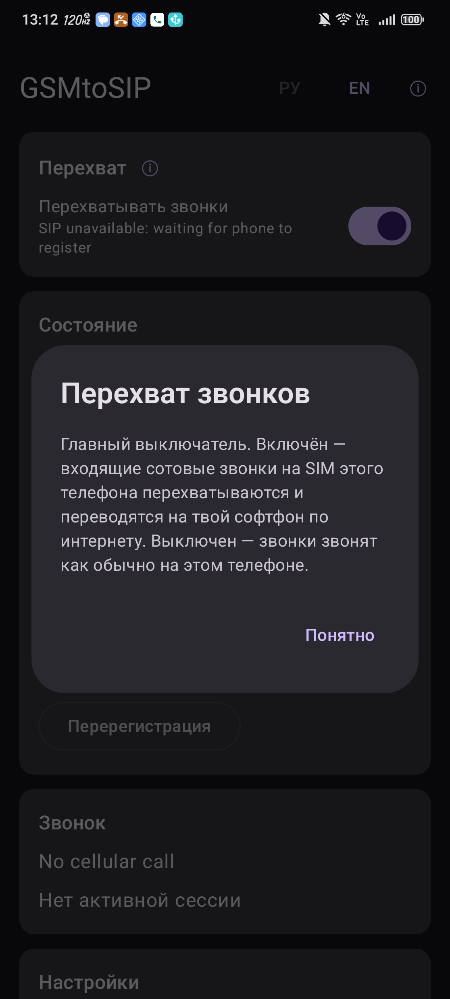
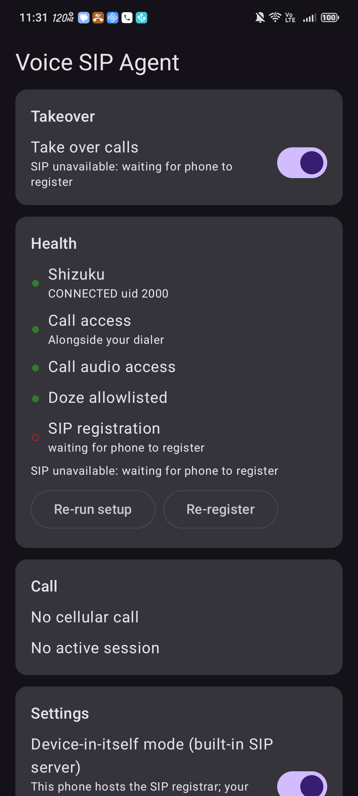
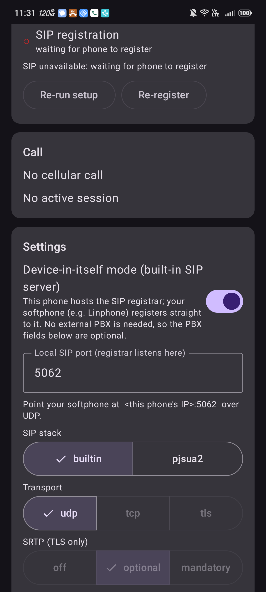
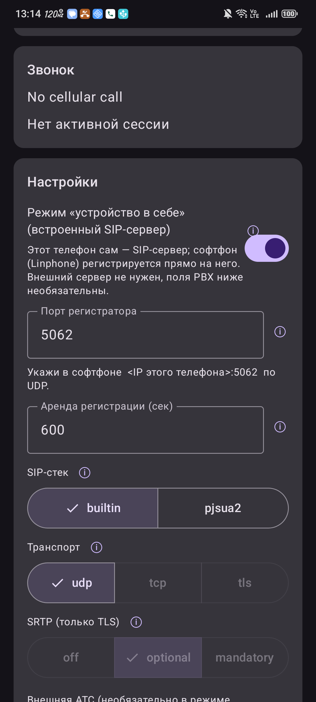
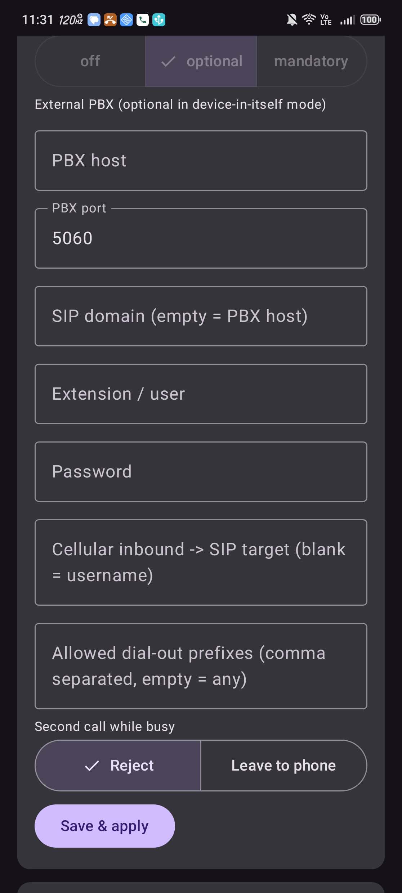
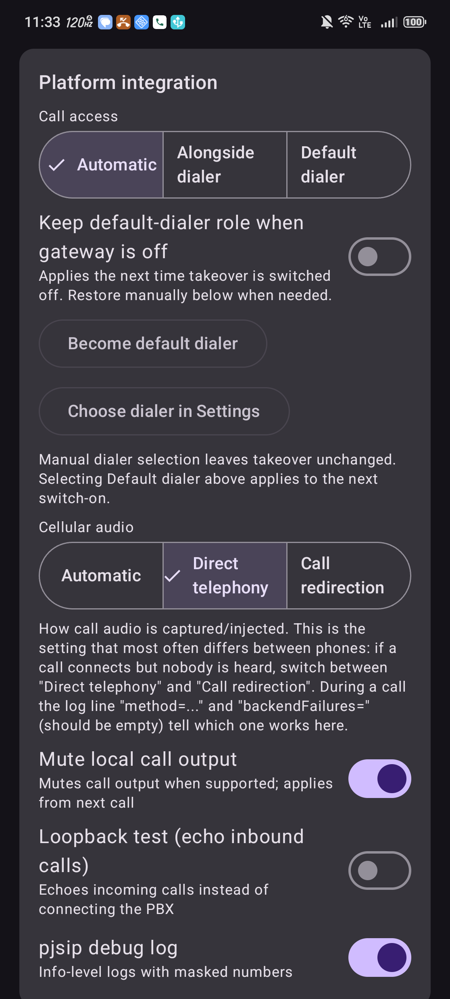
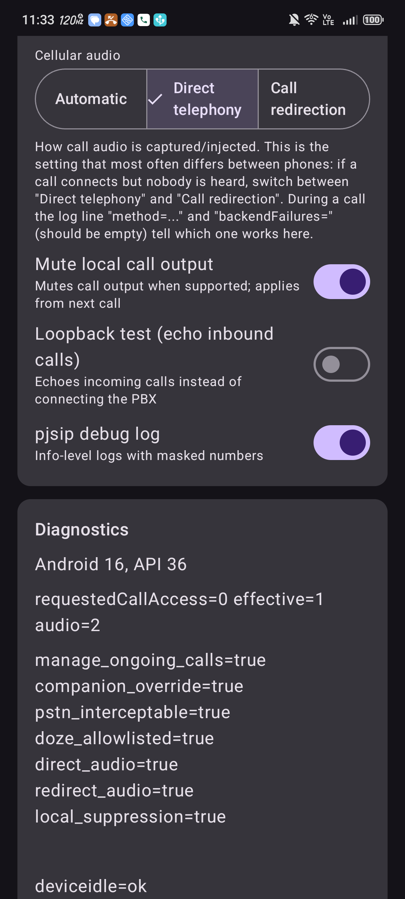

# Полный справочник настроек приложения-шлюза

Интерфейс **на русском и английском** (переключатель РУ/EN вверху экрана), у каждого пункта есть
кнопка **ⓘ** с пояснением прямо в приложении, а внизу — раздел **«Справка и частые вопросы»**.
Ниже — тот же материал справочником; рядом с русским заголовком дан английский — **как в
приложении**.

> Главная мысль: всё настраивается **прямо в приложении**, без ПК. Единственный параметр,
> реально отличающийся от телефона к телефону, — **способ захвата звука («Cellular audio»)**.
> Если звонок соединяется, но люди не слышат друг друга — переключай именно его (раздел 4.4 и
> «Диагностика проблем»).

Скриншоты сняты на Nubia NX769J (Android 16).


Нажатие на ⓘ открывает пояснение:



---

## 0. Как открыть настройки

1. Открой приложение (ярлык на телефоне-шлюзе).
2. Экран прокручивается вертикально. Сверху вниз карточки:
   **Takeover → Health → Call → Settings → Log**, внизу — кнопка **«Advanced settings»**
   (раскрывает *Platform integration* и *Diagnostics*).
3. Изменения в блоке **Settings** применяются кнопкой **«Save & apply»** внизу блока.
   Переключатели в *Advanced* и *Takeover* применяются сразу.
4. Если во время изменения идёт звонок — настройка применится после его завершения.
5. **Язык интерфейса** — кнопки **РУ / EN** в правом верхнем углу, меняется сразу.

---

## 1. Takeover (главный выключатель)



| Пункт | Что делает | По умолчанию |
|---|---|---|
| **Take over calls** | Главный тумблер шлюза. Вкл — входящие сотовые звонки перехватываются и мостятся в SIP. Выкл — звонки остаются обычной звонилке. | Вкл |

Под тумблером — текущее состояние словами: «Calls are bridged to the PBX», «waiting for phone
to register» и т.п.

---

## 2. Health (индикаторы готовности — только чтение)

Кружок слева: **зелёный** — ок, **красный** — проблема.

| Индикатор | Что проверяет | Когда красный |
|---|---|---|
| **Shizuku** | Подключение к привилегированной службе (uid 2000). | Shizuku не запущен после перезагрузки — запусти его. |
| **Call access** | Способ доступа к звонкам (companion / default dialer). | Нет нужного разрешения/роли. |
| **Call audio access** | Доступен ли бэкенд захвата для выбранного метода. | Выбранный «Cellular audio» недоступен на железе — смени метод. |
| **Doze allowlisted** | Приложение исключено из экономии батареи. | Включи исключение в системных настройках. |
| **SIP registration** | В режиме сервера: зарегистрировался ли софтфон. В режиме PBX: зарегистрирован ли шлюз на PBX. | Софтфон не на связи / неверные данные. |

Кнопки: **Re-run setup** (заново прогнать права/роли), **Re-register** (перезапустить SIP),
**Grant Shizuku** (если Shizuku ждёт разрешения).

---

## 3. Settings — основной блок (кнопка «Save & apply»)

### 3.1 Device-in-itself mode (режим «устройство в себе»)



| Пункт | Что делает |
|---|---|
| **Device-in-itself mode (built-in SIP server)** | **Вкл** (по умолчанию): этот телефон сам — SIP-сервер. Софтфон регистрируется прямо на него, внешний PBX не нужен; поля PBX можно оставить пустыми. **Выкл**: шлюз сам регистрируется на внешний PBX — тогда заполни PBX host / user / password. |

### 3.2 Local SIP port / Registration lease

| Пункт | Что делает | По умолчанию |
|---|---|---|
| **Local SIP port** / «Порт регистратора» | UDP-порт, на котором шлюз слушает регистрацию софтфона. Его указываешь в софтфоне как `<IP телефона>:<порт>`. | **5062** |
| **Registration lease (sec)** / «Аренда регистрации» | Сколько держать регистрацию. Софтфон обновляет её ~раз в половину срока, а шлюз удерживает последний адрес ещё ~два срока — поэтому короткие «засыпания» в фоне не роняют связь. **Если протухает — увеличь (напр. 1200).** | **600** |



### 3.3 SIP stack (SIP-стек)

| Значение | Что это |
|---|---|
| **builtin** (по умолч.) | Собственный Kotlin-стек: только **UDP** и кодек **G.711** (узкополосный). Без нативных библиотек. |
| **pjsua2** | Нативный pjsip (TCP/TLS, Opus). **В этой сборке не включён** — оставлен на будущее. |

### 3.4 Transport / SRTP

| Пункт | Значения | Примечание |
|---|---|---|
| **Transport** | udp / tcp / tls | С `builtin`-стеком — только **udp**. tcp/tls — только с pjsua2. |
| **SRTP (TLS only)** | off / optional / mandatory | Шифрование медиа, только при TLS (pjsua2). |

### 3.5 Внешний PBX (нужен только если «Device-in-itself» выключен)



| Поле | Что это |
|---|---|
| **PBX host** | Адрес внешнего SIP-сервера/PBX. |
| **PBX port** | Порт PBX (по умолч. 5060 для udp/tcp, 5061 для tls). |
| **SIP domain (empty = PBX host)** | SIP-домен, если отличается от адреса PBX. |
| **Extension / user** | Логин (внутренний номер) на PBX. |
| **Password** | Пароль. Хранится зашифрованным (Android Keystore). |

### 3.6 Маршрутизация и дозвон

| Поле | Что это |
|---|---|
| **Cellular inbound -> SIP target (blank = username)** | Куда направлять входящий сотовый звонок. Пусто = на зарегистрированный телефон. |
| **Allowed dial-out prefixes (empty = any)** | Разрешённые префиксы исходящего набора через SIM (на будущее). Пусто = любой номер. |

### 3.7 Second call while busy

| Значение | Что делает |
|---|---|
| **Reject** (по умолч.) | Второй входящий во время разговора отклоняется. |
| **Leave to phone** | Второй сотовый звонок оставляется штатной звонилке, SIP-стороне возвращается «занято». |

**Не забудь нажать «Save & apply».**

---

## 4. Advanced settings → Platform integration

Раскрывается кнопкой **«Advanced settings»**. Переключатели применяются сразу.



### 4.1 Call access (способ доступа к звонкам)

| Значение | Что делает | Когда выбирать |
|---|---|---|
| **Automatic** (по умолч.) | Приложение само выбирает способ. | Оставить, если работает. |
| **Alongside dialer** (companion) | Перехват рядом со штатной звонилкой, не забирая роль «телефон по умолчанию». | Предпочтительно. |
| **Default dialer** | Шлюз становится «Телефоном по умолчанию». | Если в companion звук/перехват не работают. |

### 4.2 Keep default-dialer role when gateway is off

Если шлюз был «телефоном по умолчанию» — при выключении оставить роль за ним. Применяется при
следующем выключении.

### 4.3 Кнопки ролей

- **Become default dialer** — вручную сделать шлюз звонилкой по умолчанию.
- **Choose dialer in Settings** — открыть системный выбор звонилки.
- **Restore previous dialer** — вернуть прежнюю.

### 4.4 ⭐ Cellular audio (способ захвата звука) — ГЛАВНЫЙ параметр при проблемах со звуком



| Значение | Внутр. | Что делает |
|---|---|---|
| **Automatic** | 0 (AUTO) | Выбирает метод сам. **На некоторых телефонах выбирает неправильно** (на Нубии ставил «redirection», где звука нет). |
| **Direct telephony** | 2 (LEGACY) | Прямой захват/инжекция в тракт телефонии. **Рабочий метод на Nubia NX769J.** |
| **Call redirection** | 1 (OFFICIAL) | Официальная переадресация звука (Android 13+). На части устройств падает с `record read 0`. |

**Как понять, какой метод нужен на новом телефоне:**
1. Включи `pjsip debug log` (ниже), сделай тестовый звонок.
2. В журнале (блок **Log** или `adb logcat -s VoiceSipAgent VsaTap`) найди строку
   `tap closed ... method=... backendFailures=...`.
3. Правильный метод: `backendFailures=` **пусто**, а `downPeak`/`upPeak` **ненулевые** и люди
   слышат друг друга. Если есть `record read 0` или тишина — переключи метод и позвони снова.

### 4.5 Mute local call output

Глушить вывод звука вызова из динамика самого шлюза, пока идёт мост. По умолчанию — вкл.

### 4.6 Loopback test (echo inbound calls)

Диагностика: входящие не соединяются с SIP, «эхо» возвращается звонящему. В обычной работе — выкл.

### 4.7 pjsip debug log

Подробный журнал (info-уровень), номера маскируются. Включай для диагностики.

---

## 5. Advanced settings → Diagnostics (только чтение)

Версия Android/API, `requestedCallAccess / effective / audio`, привилегированные флаги железа:

| Флаг | Значение |
|---|---|
| `pstn_interceptable=true` | Железо поддерживает перехват звука вызова. |
| `direct_audio=true` | Доступен метод «Direct telephony». |
| `redirect_audio=true` | Доступен метод «Call redirection». |
| `manage_ongoing_calls`, `companion_override` | Права на управление звонками. |
| `doze_allowlisted=true` | Исключение из экономии батареи активно. |
| `local_suppression=true` | Доступно глушение локального вывода. |

> Счётчики звука **не доказывают**, что звук дошёл до собеседника — проверяй обе стороны на слух.

---

## 6. Диагностика проблем — что крутить

| Симптом | Что проверить / сменить |
|---|---|
| **Софтфон виснет на «подключении», регистрации нет** | 1) На шлюзе не включён ли посторонний **VPN**. 2) Оба в одной сети, изоляция клиентов в роутере выключена. 3) Верный `IP:порт` и транспорт **UDP**, порт `:5062` в AoR. |
| **Звонок соединился, тишина / не слышат** | **Cellular audio**: переключить **Direct telephony** ↔ **Call redirection**. Проверить `backendFailures=` (должно быть пусто). |
| **Меня не слышат, я слышу** | Выдать **софтфону доступ к микрофону** (разрешение на дальнем телефоне). |
| **Звонок уходит на обычную звонилку** | `SIP registration` красный → переоткрыть софтфон. Либо `Call access` → **Default dialer**. |
| **Регистрация слетает** | 1) У софтфона выключить оптимизацию батареи, разрешить фон/автозапуск. 2) Увеличить «Аренду регистрации» (напр. 1200). 3) У ШЛЮЗА тоже снять оптимизацию батареи для приложения и Shizuku. |
| **Shizuku красный после перезагрузки** | Запустить Shizuku заново (USB или беспроводная отладка), затем **Grant Shizuku**. См. `shizuku-reboot.md`. |

---

## 7. Те же настройки через adb (без UI)

Приёмник: `AdbControlReceiver`.

```bash
R=io.github.sparkcyf.voicesipagent/io.github.sparkcyf.voicesipagent.app.AdbControlReceiver
adb shell am broadcast -n $R --es op status                         # сводка состояния
adb shell am broadcast -n $R --es op provision --ei audio_method 2  # 0=Auto 1=redirection 2=direct
adb shell am broadcast -n $R --es op provision --ei call_access 0   # 0=Auto 1=companion 2=dialer
adb shell am broadcast -n $R --es op provision --es target s23      # inbound -> SIP target
adb shell am broadcast -n $R --es op sms-test --es from "+700..." --es text "тест"
adb shell am broadcast -n $R --es op loopback --ez on true          # эхо-тест
adb shell am broadcast -n $R --es op sip-debug --ez on true         # подробный лог
adb logcat -s VoiceSipAgent VsaTap VsaPrivileged                    # журнал
```

> `provision` принимает также `--es server`, `--ei port`, `--es user`, `--es password`,
> `--es domain`, `--es transport`, `--es srtp`, `--es prefixes`.
> **audio_method:** `0` = Automatic, `1` = Call redirection, `2` = Direct telephony.
