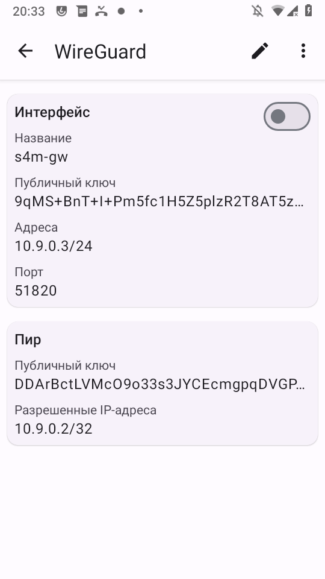
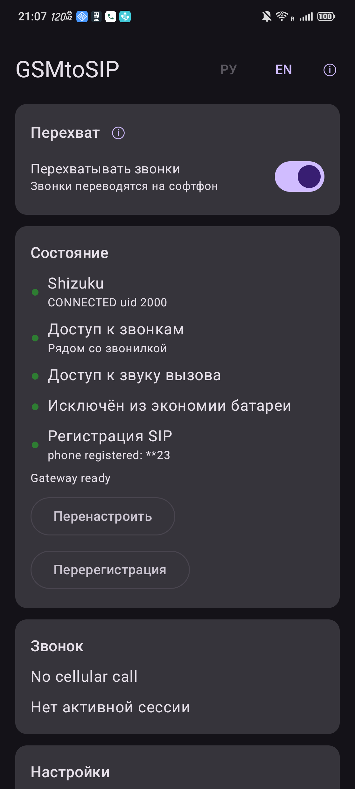

# WireGuard: шлюз сам себе VPN-сервер

> ℹ VPN - это **запасной** путь выхода в интернет. Основной выбор владельца - прямой доступ
> (белый IP + проброс портов), см. [`internet-security.md`](internet-security.md). VPN нужен,
> если белого IP нет (CGNAT) или не хочешь светить SIP наружу.

Чтобы звонки и SMS доходили **из любой точки**, а не только внутри домашней Wi-Fi, софтфон и
шлюз надо объединить в одну overlay-сеть. Самый самодостаточный вариант - **поднять
VPN-сервер прямо на телефоне-шлюзе**: отдельный VPS/роутер не нужен, рут не нужен, наружу
торчит только тихий UDP-порт WireGuard (а не SIP - это снимает весь toll-fraud риск, см.
[`internet-security.md`](internet-security.md)).

> ✅ **Проверено 22.10.2026.** Софтфон baresip зарегистрировался на шлюз (voicesipagent)
> **через WireGuard-overlay** — индикатор зелёный, в журнале шлюза
> `phone registered: s23 @ 10.9.0.2:…` (overlay-адрес, не LAN). Ниже — ровно та схема, что
> сработала, со скриншотами.

## Что нужно и чего не хватит

Приложение WireGuard слушает свой порт через системный `VpnService` — поэтому **телефон-шлюз
может быть сервером сам по себе, без рута**. Но VPN-сервер на телефоне ещё не делает его
видимым из интернета:

- **Если у дома белый (публичный, без CGNAT) IP** — достаточно пробросить на роутере **один
  UDP-порт 51820** на телефон-шлюз. Наружу видно только WireGuard; SIP/RTP живут внутри туннеля.
- **Если IP серый (CGNAT) с обеих сторон** — прямого проброса не сделать. Тогда нужна одна
  точка с предсказуемым адресом — **координатор NAT-traversal**: лёгкий публичный узел, который
  сам трафик не гоняет, а только помогает сторонам пробить дыры в NAT и найти друг друга (не
  вышло напрямую — трафик идёт через relay). Так работают **Tailscale/Headscale, Netbird,
  ZeroTier, Nebula**. «Статичный IP» при этом нужен только у координатора — подойдёт любой
  дешёвый VPS или бесплатный уровень Tailscale. Это и есть тот «сервис, когда устройства с
  динамическим IP находят друг друга».

Дальше — чистый WireGuard для случая с белым IP (или когда оба телефона в одной сети и ты
просто хочешь проверить схему).

## Overlay-адресация (пример теста)

| Узел | overlay-IP | Роль | Порт |
|---|---|---|---|
| Телефон-шлюз (эта SIM) | `10.9.0.1/24` | сервер | 51820 |
| Дальний телефон (софтфон) | `10.9.0.2/24` | клиент | — |

(Если шлюзов два — второй берёт `10.9.0.3/24` и поднимает свой сервер, см. раздел «Два шлюза».)

## Шаг 1. Поставить WireGuard

На **оба** телефона — [WireGuard](https://f-droid.org/packages/com.wireguard.android/)
(`com.wireguard.android`, F-Droid; официальный APK — с download.wireguard.com).

## Шаг 2. Сгенерировать ключи и два конфига

У каждого узла своя пара ключей (приватный хранится только у него, публичный отдаётся пиру).
Пары можно сделать прямо в приложении («Создать с нуля») или на ПК (`wg genkey | tee priv | wg pubkey`).

**Конфиг шлюза (сервер), `gw.conf`:**

```ini
[Interface]
PrivateKey = <приватный ключ шлюза>
Address    = 10.9.0.1/24
ListenPort = 51820

[Peer]
# дальний телефон (софтфон)
PublicKey  = <публичный ключ софтфона>
AllowedIPs = 10.9.0.2/32
```

**Конфиг софтфона (клиент), `client.conf`:**

```ini
[Interface]
PrivateKey = <приватный ключ софтфона>
Address    = 10.9.0.2/24

[Peer]
# телефон-шлюз
PublicKey           = <публичный ключ шлюза>
Endpoint            = <белый IP или домен дома>:51820
AllowedIPs          = 10.9.0.1/32
PersistentKeepalive = 25
```

> ✅ **Рекомендуется раздельный туннель (split-tunnel): `AllowedIPs = 10.9.0.1/32`** - только
> overlay-адрес шлюза, а не `0.0.0.0/0`. Тогда через VPN идут **только** звонки и SMS (трафик к
> шлюзу), а весь остальной интернет телефона - напрямую. Это важно, если шлюз в другой стране:
> с полным туннелем (`0.0.0.0/0`) весь трафик телефона пошёл бы через страну шлюза.
>
> Почему это должно работать: маршрут к `10.9.0.1` уходит в `tun0`, пакет берёт источником
> overlay-адрес `10.9.0.2`, и шлюз принимает REGISTER и отвечает по тому же туннелю. (Если
> шлюзов два, укажи всю overlay-подсеть - `10.9.0.0/24`.)
>
> ⚠ **Честно:** split-tunnel-на-overlay-IP выведен по логике маршрутизации и **на устройствах в
> поле пока не проверялся**. Прежний зелёный тест (22.10.2026, ниже) шёл на стенде с **полным**
> туннелем (`0.0.0.0/0`) в одной Wi-Fi - считай это стендовой мерой, а не рекомендацией. Если на
> твоём софтфоне split-tunnel не поднимет регистрацию, для проверки временно поставь
> `0.0.0.0/0` и сравни.
>
> `PersistentKeepalive = 25` держит NAT-привязку живой, чтобы входящий звонок разбудил туннель.

## Шаг 3. Импортировать конфиг в приложение

На каждом телефоне: WireGuard → **«+»** → **«Импорт из файла или архива»** → выбрать свой
`.conf`. (Можно и «Сканировать QR-код», и «Создать с нуля» — тогда поля вводятся руками.)


После импорта туннель виден в списке (пока выключен):


Открыв туннель, видно его состав — у шлюза это интерфейс с его overlay-адресом, портом и
пиром-софтфоном:



## Шаг 4. Включить туннель

Тумблером в списке (или вверху экрана деталей). Активный туннель — тумблер синий, в статусбаре
появляется значок VPN-ключа:


Включить надо на **обоих** телефонах.

## Шаг 5. Нацелить софтфон на overlay-адрес шлюза

В baresip аккаунт на шлюз должен смотреть на его **overlay-IP**, а не на LAN:

```
sip:s23@10.9.0.1:5062
```

и включить тумблер **«Регистрация»** (подробно — [`client-baresip.md`](client-baresip.md)).

> ⚠ У каждого аккаунта baresip **свой** тумблер «Регистрация». Если он выключен, REGISTER
> вообще не уходит (на этом в тесте потеряли время — шлюз был доступен, но клиент молчал).

## Признак успеха

- В журнале шлюза: `phone registered: s23 @ 10.9.0.2:<порт>` — источник именно overlay-адрес.
- В voicesipagent все индикаторы блока **«Состояние»** зелёные, в том числе **Регистрация SIP**
  (`phone registered: **23`), снизу — **Gateway ready**.
- В baresip аккаунт горит **🟢**.



## Два шлюза (две SIM) через один VPN

Простой и надёжный путь — **каждый шлюз поднимает свой сервер**: телефон-шлюз A =
`10.9.0.1` сервер, телефон-шлюз B = `10.9.0.3` сервер, софтфон держит **два туннеля** и две
SIP-регистрации (по одной на шлюз). Каждый шлюз пробрасывает свой UDP-порт (можно 51820 и
51821).

> ⚠ **Схему «один сервер на всех» без рута на телефоне-хабе не сделать.** Чтобы хаб
> пересылал трафик между двумя клиентами, ему нужен IP-форвардинг (`ip_forward` + MASQUERADE),
> а это рут. На нерутованном телефоне-хабе второй шлюз-клиент будет недоступен. Поэтому для
> двух SIM проще «каждый сам себе сервер», чем «один хаб».

## Диагностика

- Клиент зелёный в WireGuard, но baresip жёлтый → проверь порт `:5062` в AoR, тумблер
  «Регистрация», и что AoR указывает на overlay-IP, а не на LAN.
- Хэндшейк WireGuard не проходит (нет «последнего рукопожатия») → `Endpoint`/проброс порта,
  либо телефон-шлюз спит (дай приложению фоновую работу, отключи оптимизацию батареи).
- Регистрация доходит, но клиент всё равно красный → смотри источник ответа шлюза в журнале;
  в voicesipagent ответ уходит с того же интерфейса, куда пришёл запрос (в тесте — ОК).
